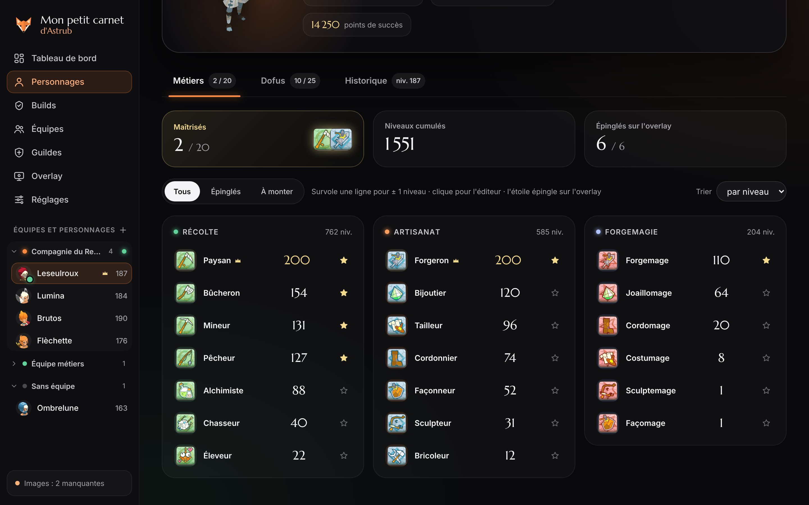
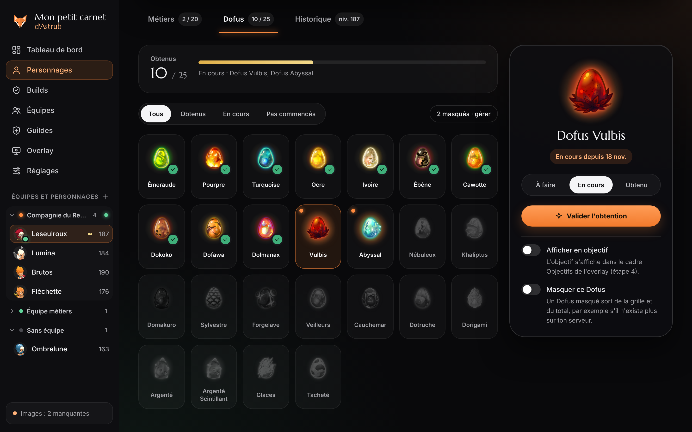
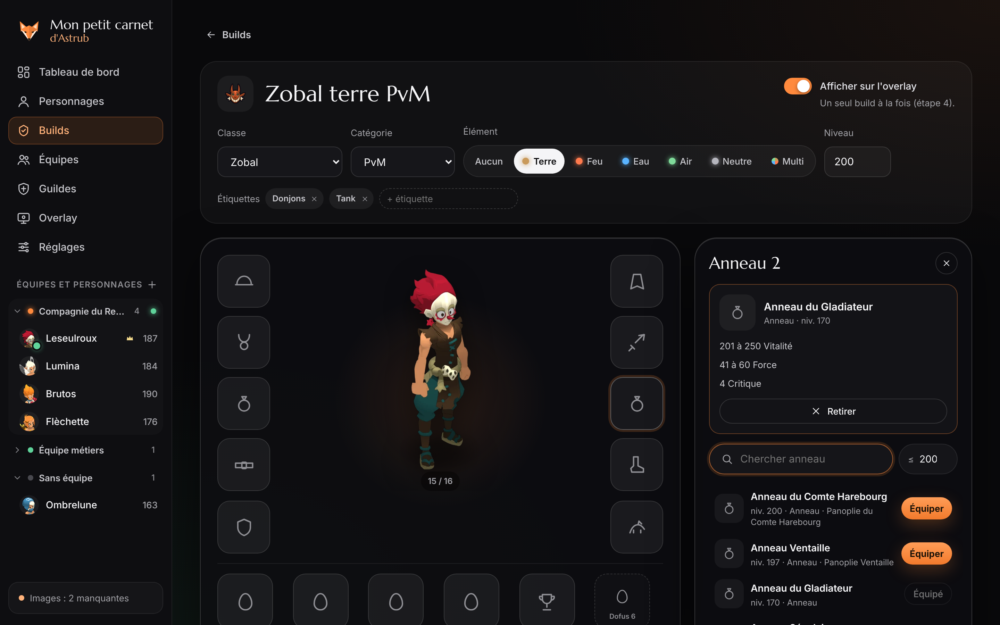
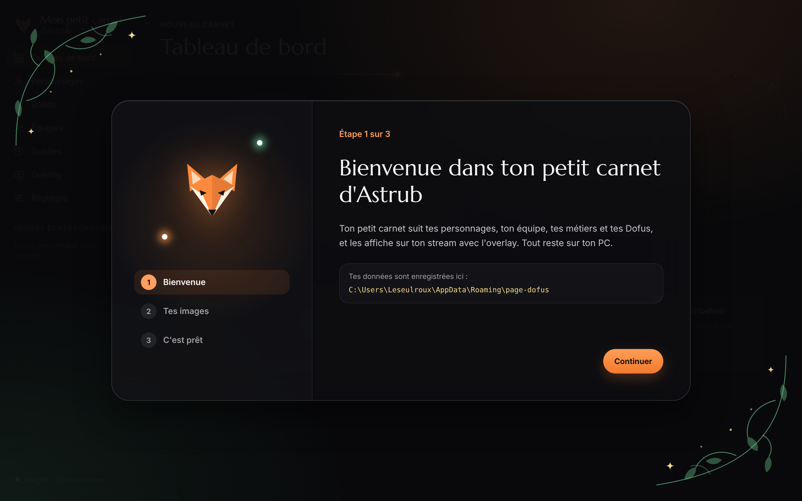

  

<h1 align="center">Mon petit carnet d'Astrub</h1>

  Le carnet d'aventure Dofus de <a href="https://twitch.tv/leseulrouxx">Leseulroux</a> : suivre ses personnages, son équipe, ses métiers et ses Dofus, et les afficher en direct sur le stream.

  <a href="../../releases/latest"><b>Télécharger la dernière version</b></a>

  

## Ce que fait Mon petit carnet d'Astrub

Mon petit carnet d'Astrub est une application Windows pensée pour les joueurs de Dofus 3 qui streament.

- **Carnet de personnages** : niveau, métiers, Dofus obtenus ou en cours, pour un personnage seul ou une équipe multicompte.
- **Overlay Streamlabs** : une fiche compacte qui tourne entre plusieurs pages (personnage, Dofus, métiers, équipement), et des animations plein écran quand tu montes de niveau ou obtiens un Dofus.
- **Builds** : une bibliothèque de builds partagée par tous tes personnages, avec un build actif affiché sur l'overlay.
- **Tout reste sur ton PC** : pas de compte et pas de serveur. Tes données sont de simples fichiers dans `%APPDATA%\page-dofus`.

## Où en est le projet

| Version | Contenu | État |
|---|---|---|
| 0.1 | Base : stockage, référentiel du jeu, images, réglages | Disponible |
| 0.2 | Personnages, équipes, guildes | Disponible |
| 0.3 | Métiers, Dofus, historique, objectifs, builds, personnages | Disponible |
| 0.4 | Overlay Streamlabs et événements | À venir |
| 0.5 | Installeur et mises à jour automatiques | À venir |

  

  
  

  
  

## Installer

1. Télécharge le fichier `page-dofus-x.y.z-windows.zip` de la [dernière version](../../releases/latest).
2. Dézippe-le où tu veux et lance `page-dofus.exe`.
3. Au premier lancement, Windows peut afficher « Windows a protégé votre ordinateur », car l'application n'est pas encore signée. Clique sur **Informations complémentaires**, puis **Exécuter quand même**.

Il faut Windows 10 ou 11 avec Microsoft Edge WebView2, déjà présent sur les systèmes à jour.

### Les images du jeu

Les icônes de Dofus, de classes et de métiers appartiennent à Ankama et ne sont pas distribuées ici. L'application lit ton propre dossier d'images : au premier lancement, choisis-le à l'étape « Tes images », ou dépose tes fichiers dans `%APPDATA%\page-dofus\assets`.

### Désinstaller

Supprime le dossier de l'application, et `%APPDATA%\page-dofus` si tu veux aussi effacer tes données.

  
  

## Mentions

Mon petit carnet d'Astrub est un projet de fan, gratuit et non officiel. Il n'est ni affilié à Ankama, ni approuvé par Ankama. Dofus et les éléments du jeu sont des marques et des créations d'Ankama.

Mon petit carnet d'Astrub intègre des composants open source (Wails, React, Go, polices Inter et Marcellus) ; leurs licences sont regroupées dans [AVIS-TIERS.md](AVIS-TIERS.md). Les données des équipements viennent de l'API publique [dofusdude](https://dofusdu.de).

© Leseulroux. Tous droits réservés : l'application est libre de téléchargement et d'utilisation, mais son code n'est pas publié.
