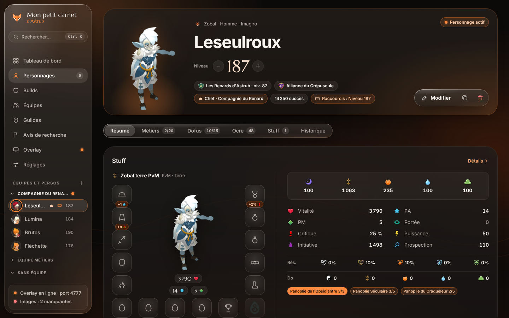
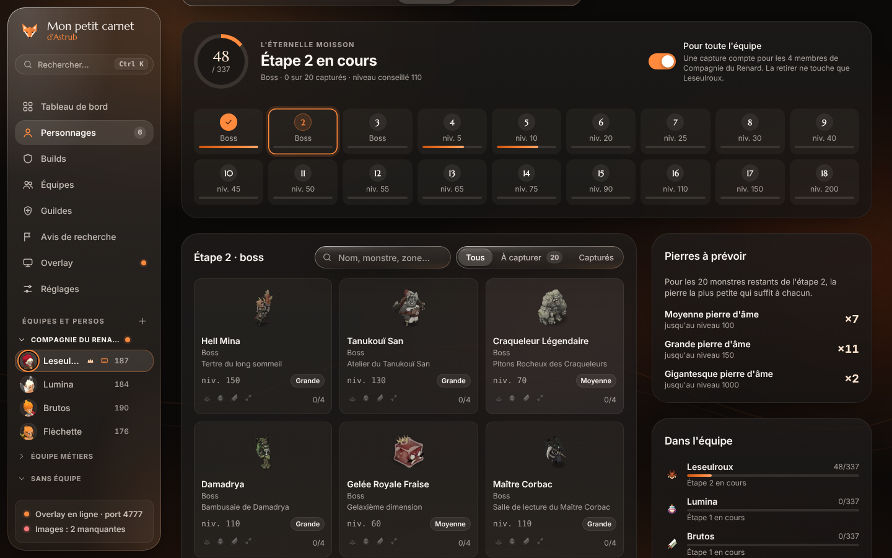
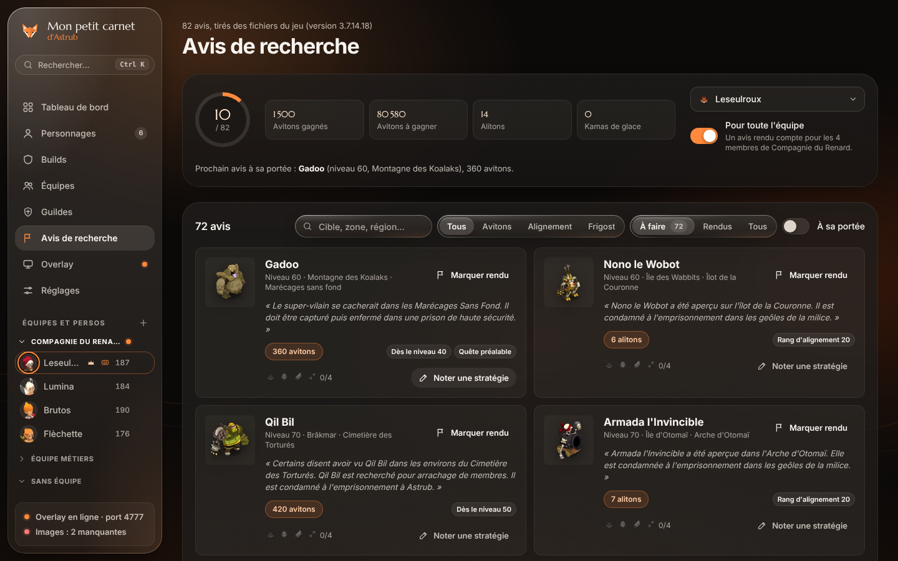
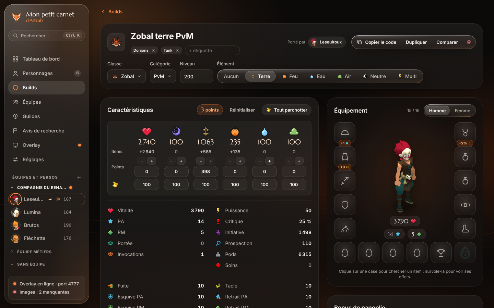
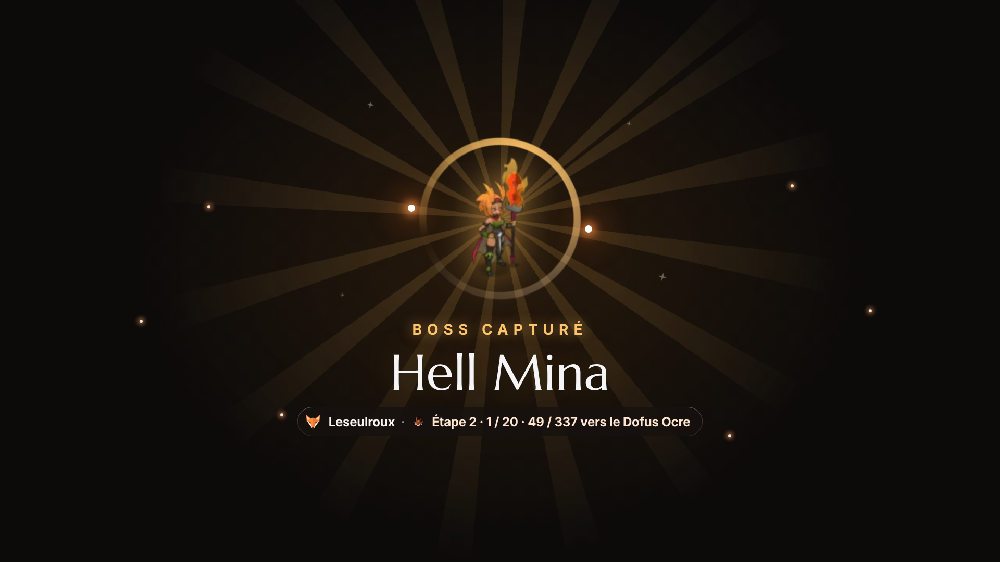
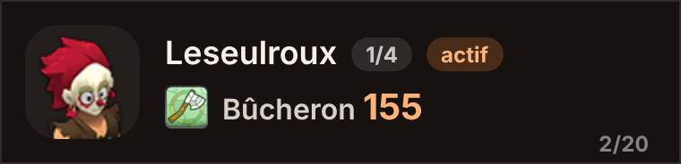
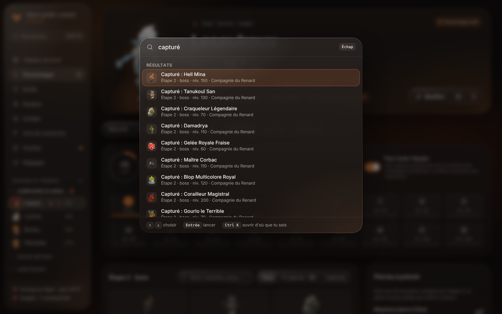

# Mon petit carnet d'Astrub

Le carnet d'aventure Dofus de tes personnages, avec son overlay pour Streamlabs et OBS.
Niveaux, métiers, Dofus, quête du Dofus Ocre, avis de recherche, builds, équipes : tout se suit dans une app Windows, et ton stream l'affiche en direct.

**[Télécharger la dernière version](../../releases/latest)** (Windows 10 et 11, gratuit, sans compte)

## Ce que fait l'app

### Tes personnages et ton équipe

- Jusqu'à 8 personnages par équipe, un chef, l'équipe et le personnage que tu joues.
- Serveurs monocompte, guildes et alliances avec leur blason, skins animés (par défaut ou les tiens).
- Niveau, 20 métiers, 27 Dofus, historique annulable et courbe de niveau.
- Statistiques par semaine et par mois, objectifs (un niveau, un métier, une étape de l'Ocre ou un compteur libre).

### Le Dofus Ocre, étape par étape

- Les 337 boss et archimonstres de « L'éternelle moisson », avec leur image, leurs niveaux, leurs zones et le monstre dont l'archi est la version rare.
- Un clic marque une capture, pour toi ou pour toute l'équipe.
- La recherche trouve un monstre par son nom, son monstre de base ou sa zone.
- Les pierres d'âme à prévoir pour finir l'étape, taille par taille.
- La première capture met l'Ocre « en cours » ; le valider marque tout ce qui reste.

### Le carnet des avis de recherche

- Les 82 avis du jeu, du niveau 20 au niveau 200 : la cible, son image, ses zones et l'indice de l'avis.
- Ce que chaque avis rapporte (avitons, alitons, kamas de glace) et ce qu'il demande (niveau, rang d'alignement, quête préalable).
- Les avis rendus par chaque perso, ou par toute l'équipe d'un clic, avec les avitons gagnés et ceux qui restent.
- Tes notes de stratégie sur chaque avis, et le prochain avis à ta portée.

### Builds

- Les équipements du jeu à jour, consultables même hors ligne.
- Un builder complet : caractéristiques, parchemins, panoplies, forgemagie.
- Un code pour partager un build, et un comparateur pour en mettre deux côte à côte.

### L'overlay pour ton stream

Des scènes à coller dans une source « Navigateur » de Streamlabs ou d'OBS. Elles se mettent à jour en direct :

| Scène | Ce qu'elle montre |
|---|---|
| Fiche | Ton perso (ou le bandeau de ton équipe) : fiche, Dofus, métiers, stuff, en rotation |
| Objectif | Tes objectifs et ceux du stream, tes Dofus en cours |
| Session | Ce que le live a rapporté : niveaux, Dofus, métiers, captures |
| Événements | Une annonce plein écran avec son à chaque niveau, Dofus, métier ou capture d'archimonstre |

### Au clavier, même en plein jeu

Les raccourcis marchent même quand Dofus a le focus. Tu les changes dans Réglages > Raccourcis clavier.

| Raccourci | Action |
|---|---|
| Ctrl+Alt+↑ / ↓ | +1 / −1 sur ce que vise le membre sélectionné : son niveau, un métier, ou un Dofus (un appui le commence, deux le valident) |
| Ctrl+Alt+→ / ← | Membre suivant ou précédent de l'équipe, sans changer le perso mis en avant sur le stream |
| Ctrl+Alt+Fin | Changer de catégorie : niveau, métiers, Dofus |
| Ctrl+Alt+Page ↑ / Page ↓ | Métier ou Dofus précédent ou suivant (épinglés et en cours d'abord) |
| Ctrl+Alt+O | Masquer ou réafficher l'overlay |

Une petite fenêtre te montre qui est sélectionné et ce que tu modifies. Elle n'apparaît que sur ton écran, pas sur le stream, et tu choisis où (un coin de l'écran de ton choix). Dans l'app, « Viser au clavier » sur un métier ou un Dofus le choisit à la souris.

Dans l'app, Ctrl+K trouve tout : un écran, un perso, une action, « Capturé : » suivi du nom d'un archimonstre, « Avis rendu : » suivi d'une cible. Ctrl+Z annule n'importe quelle modification.

## Installer

1. Télécharge `page-dofus-setup-X.Y.Z.exe` dans la [dernière version](../../releases/latest).
2. Lance-le. L'installation se fait pour ta session, sans droits administrateur.
3. Si Windows affiche « Windows a protégé votre ordinateur » : clique sur « Informations complémentaires », puis « Exécuter quand même ». L'app n'est pas signée par un certificat payant, Windows ne la connaît donc pas encore. Ce n'est pas un virus détecté.

Les mises à jour se proposent ensuite dans l'app (Réglages > Mises à jour). Chaque fichier est vérifié par son empreinte SHA-256 avant d'être lancé.

Une version portable (zip) est aussi publiée avec chaque version : dézippe-la où tu veux et lance `page-dofus.exe`.

## Brancher l'overlay

1. Dans l'app, ouvre l'écran **Overlay** et copie l'adresse d'une scène (`http://127.0.0.1:4777/overlay/...`).
2. Dans Streamlabs ou OBS, ajoute une source **Navigateur** avec cette adresse, à la taille indiquée sous l'adresse.
3. L'overlay ne répond qu'à ton PC (127.0.0.1 ou localhost) : personne d'autre ne peut s'en servir.

## Tes données

- Tout reste sur ton PC, dans `%APPDATA%\page-dofus` : pas de compte, pas de serveur.
- Une sauvegarde zip est faite automatiquement (et juste avant chaque mise à jour). Tu peux exporter et importer tes données depuis les réglages.

## Mentions

Les noms, images et données de Dofus appartiennent à Ankama Games. Ils sont extraits des fichiers du jeu publiés par le projet [dofusdude](https://github.com/dofusdude) et ne servent qu'au suivi de ta progression.
Mon petit carnet d'Astrub est un outil de fan, non officiel, sans lien avec Ankama.

Les captures d'écran montrent les données de démonstration de l'app.

Les nouveautés de chaque version sont dans les [notes de version](../../releases).
