

  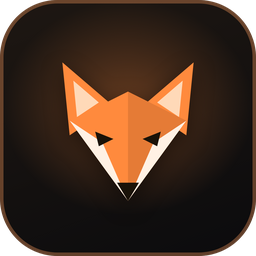

<h1 align="center">Mon petit carnet d'Astrub</h1>

  Le carnet d'aventure Dofus de <a href="https://twitch.tv/leseulrouxx">Leseulroux</a> : suivre ses personnages, son équipe, ses métiers et ses Dofus, et les afficher en direct sur le stream.

  <a href="../../releases/latest"><b>Télécharger la dernière version</b></a>

  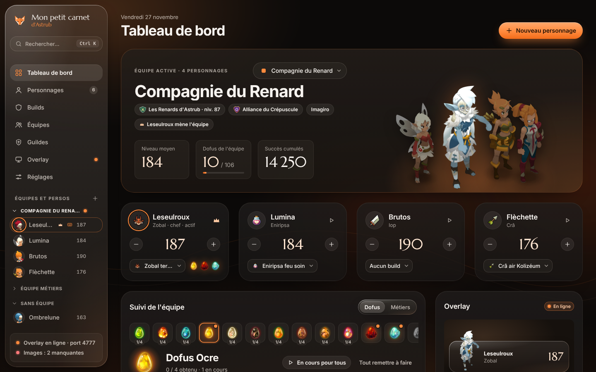

## Ce que fait Mon petit carnet d'Astrub

Mon petit carnet d'Astrub est une application Windows pensée pour les joueurs de Dofus 3 qui streament.

- **Carnet de personnages** : niveau, métiers, Dofus obtenus ou en cours, guilde et alliance, pour un personnage seul ou une équipe multicompte, avec une page résumé par personnage.
- **Overlay Streamlabs** : une fiche compacte qui tourne entre plusieurs pages (personnage, Dofus, métiers, équipement), et des animations plein écran, avec leur son, quand tu montes de niveau ou obtiens un Dofus.
- **Builds** : un builder complet (caractéristiques, parchemins, stats calculées, inventaire façon jeu) et une bibliothèque partagée par tous tes personnages ; chacun porte le sien, l'overlay montre celui du personnage à l'écran, et un code de partage permet d'échanger un build.
- **Tout reste sur ton PC** : pas de compte et pas de serveur. Tes données sont de simples fichiers dans `%APPDATA%\page-dofus`.

## Où en est le projet

| Version | Contenu | État |
|---|---|---|
| 0.1 | Base : stockage, référentiel du jeu, images, réglages | Disponible |
| 0.2 | Personnages, équipes, guildes | Disponible |
| 0.3 | Métiers, Dofus, historique, objectifs, builds, personnages | Disponible |
| 0.4 | Overlay Streamlabs et événements | Disponible |
| 0.5 | Installeur et mises à jour automatiques | Disponible |
| 0.6 | Suivi d'équipe, page résumé, guilde et alliance, sons des événements | Disponible |
| 0.7 | Builder complet : caractéristiques, stats, inventaire façon jeu, code de partage | Disponible |
| 0.8 | Bonus de panoplie, infobulles d'items, forgemagie, résumé et overlay Stuff repensés | Disponible |
| 1.0 | Grosse passe de performance, interface plus vivante, nouvelles fonctions | Prévu |

  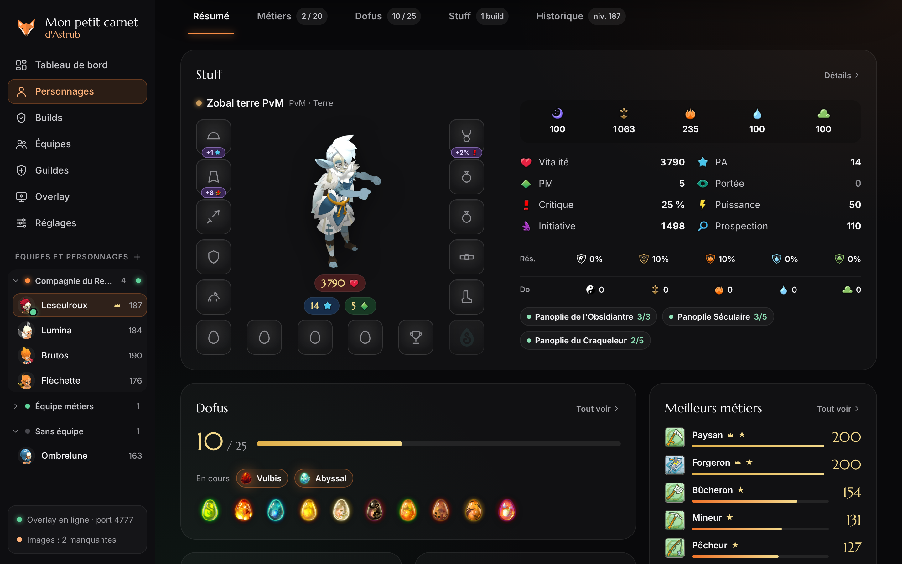

  
  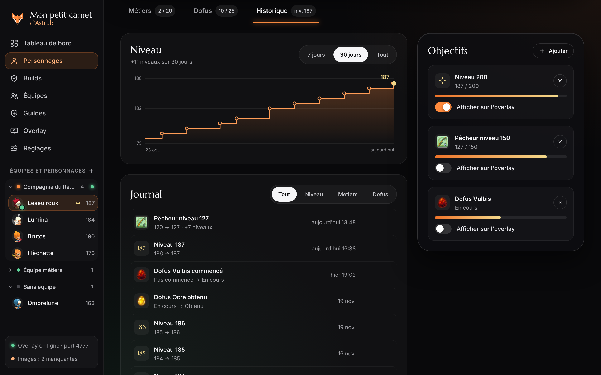

  
  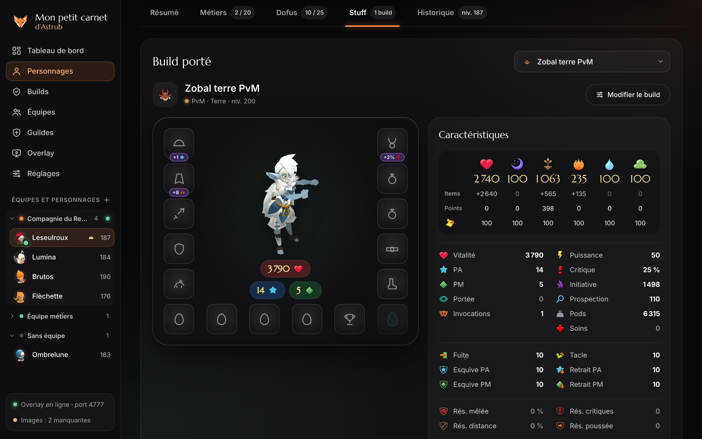

  
  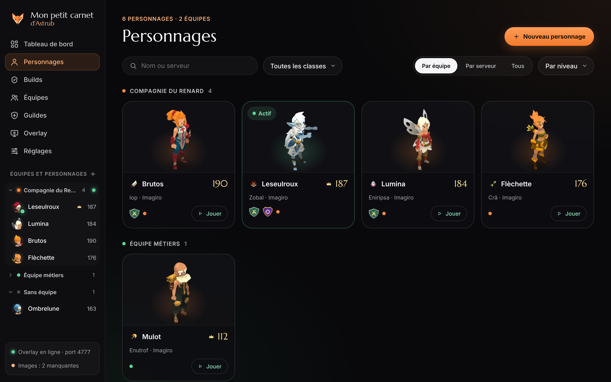

## L'overlay

L'app sert l'overlay sur ton PC (`http://127.0.0.1:4777`). Dans l'écran Overlay, copie l'adresse d'une scène et colle-la dans une source navigateur de Streamlabs ou d'OBS : la fiche se met à jour toute seule, et les événements (niveau, Dofus, métier) passent en plein écran.

  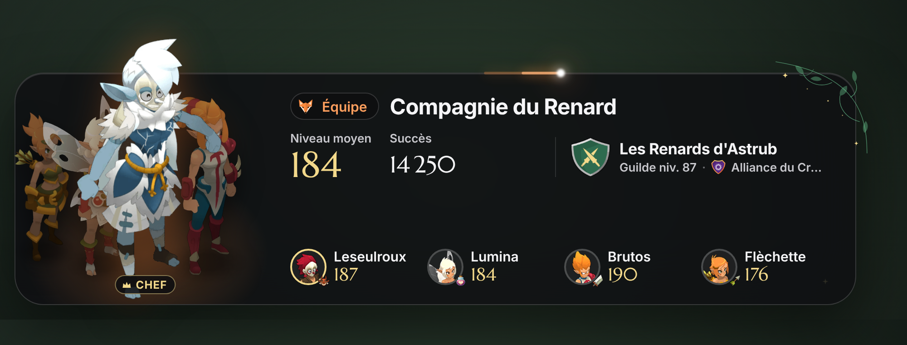

  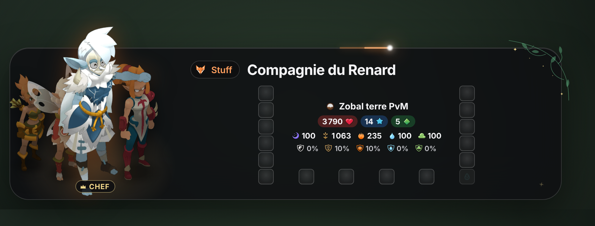

  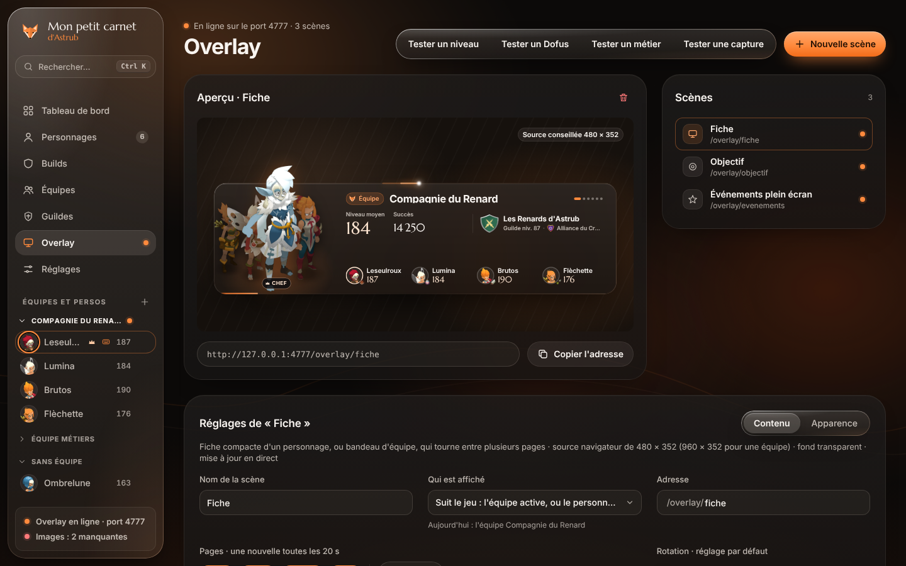
  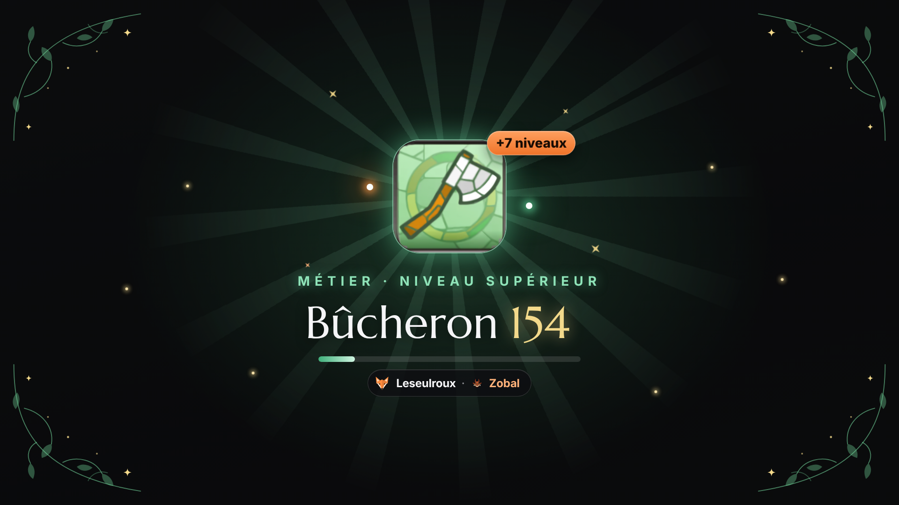

## Installer

1. Télécharge `page-dofus-setup-x.y.z.exe` dans la [dernière version](../../releases/latest) et lance-le.
2. L'installation se fait pour ton compte Windows, sans droits administrateur, avec un raccourci dans le menu Démarrer et sur le bureau.
3. Windows peut afficher « Windows a protégé votre ordinateur », car l'application n'est pas encore signée. Clique sur **Informations complémentaires**, puis **Exécuter quand même**.

Les mises à jour s'installent ensuite depuis l'app : elle vérifie au lancement si une nouvelle version est sortie, affiche ses nouveautés, puis la télécharge, vérifie son empreinte SHA-256 et se met à jour toute seule, après une sauvegarde de tes données.

Tu préfères une version portable ? Prends le zip `page-dofus-x.y.z-windows.zip`, dézippe-le où tu veux et lance `page-dofus.exe` (les mises à jour se téléchargent alors à la main).

Il faut Windows 10 ou 11 avec Microsoft Edge WebView2, déjà présent sur les systèmes à jour ; l'installeur te prévient s'il manque.

### Les images du jeu

Les icônes de Dofus, de classes et de métiers appartiennent à Ankama et ne sont pas distribuées ici. L'application lit ton propre dossier d'images : au premier lancement, choisis-le à l'étape « Tes images », ou dépose tes fichiers dans `%APPDATA%\page-dofus\assets`.

### Désinstaller

Paramètres de Windows > Applications > Mon petit carnet d'Astrub > Désinstaller. Tes données (`%APPDATA%\page-dofus`) sont gardées, sauf si tu demandes à les effacer. Version portable : supprime simplement son dossier.

  
  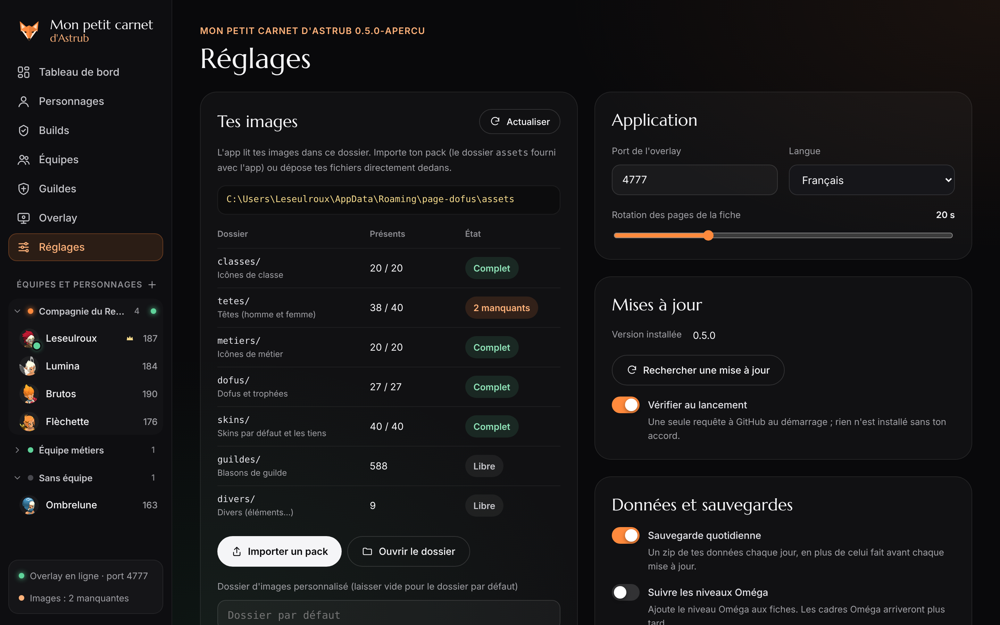

## Mentions

Mon petit carnet d'Astrub est un projet de fan, gratuit et non officiel. Il n'est ni affilié à Ankama, ni approuvé par Ankama. Dofus et les éléments du jeu sont des marques et des créations d'Ankama.

Mon petit carnet d'Astrub intègre des composants open source (Wails, React, Go, polices Inter et Marcellus) ; leurs licences sont regroupées dans [AVIS-TIERS.md](AVIS-TIERS.md). Les données des équipements viennent de l'API publique [dofusdude](https://dofusdu.de).

© Leseulroux. Tous droits réservés : l'application est libre de téléchargement et d'utilisation, mais son code n'est pas publié.
